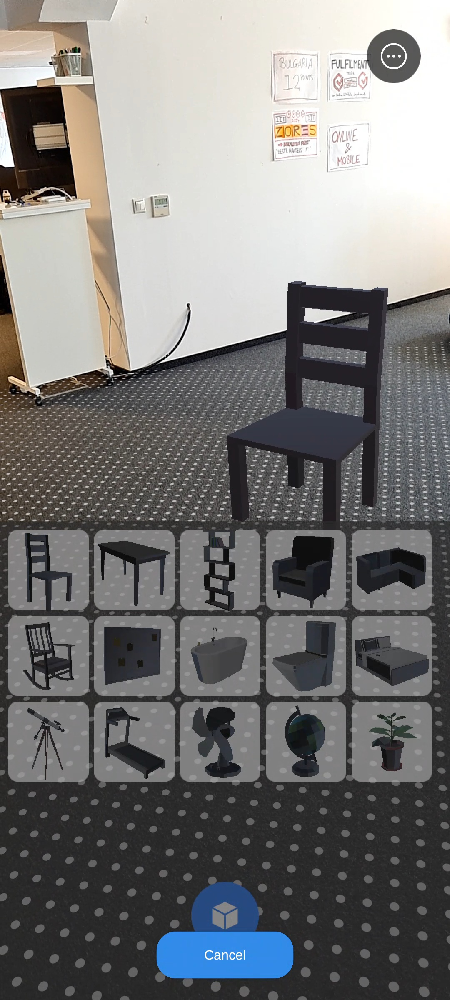
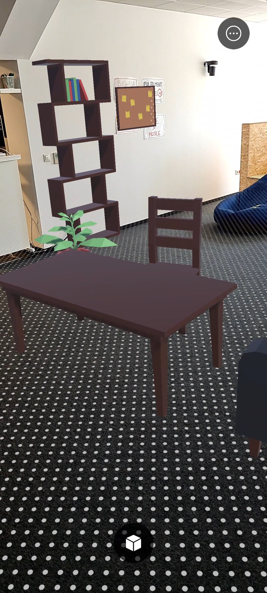

# MebelAR - Augmented Reality Furniture Visualizer

[](https://unity.com/)
[](https://unity.com/srp/Universal-Render-Pipeline)
[](https://docs.unity3d.com/Packages/com.unity.xr.arfoundation@4.2/manual/index.html)
[-orange.svg?logo=android)](https://developers.google.com/ar)
[](https://github.com/PrashantYadav806577)

**MebelAR** is an immersive Android Augmented Reality (AR) mobile application built with Unity that allows users to preview, place, move, scale, and rotate realistic 3D furniture models directly inside their real-world environment in real time.

---

## 📌 Project Overview

MebelAR empowers homeowners, interior designers, and furniture shoppers to visualize how various furniture items fit into their actual living spaces before making purchase or layout decisions. 

Utilizing plane detection and surface normal analysis, the app intelligently distinguishes between floor and wall surfaces to enforce realistic furniture placement (e.g., sofas on floors, shelves and mirrors on walls).

---

## ✨ Features

- **Multi-Surface Detection**:
  - Automatic detection of horizontal planes (floors, table tops) and vertical planes (walls).
  - Dynamic plane visualization and feathered plane mesh rendering.
- **Intelligent Surface Constraints**:
  - Differentiates ground-bound items (sofas, beds, tables) from wall-mounted items (shelves, boards).
  - Items automatically align with surface normals and orient relative to the camera.
- **Comprehensive Furniture Catalog (15 Prefabs)**:
  - Living Room: Master Sofa, Single Sofa, Rocking Chair, Wooden Chair, Wooden Table.
  - Bedroom: Bed, Plant Pot, Desk Fan.
  - Study & Office: Telescope, Globe, Shelf, Sticky Notes Board.
  - Bathroom & Gym: Bath, Toilet, Treadmill.
- **Intuitive Touch & Gesture Controls**:
  - **Single Finger Tap/Drag**: Select, place, and drag items smoothly across surfaces.
  - **Pinch-to-Scale**: Resize furniture proportionally to test different item dimensions.
  - **Twist-to-Rotate**: Rotate items around their vertical axis for optimal orientation.
- **Interactive UI & In-App Onboarding**:
  - Guided step-by-step coaching sequence (surface scan hint, tap to place hint, translate/scale hints).
  - Clean animated bottom drawer menu for catalog browsing.
  - Focused item deletion tool with one-tap removal.
- **Diagnostic & Compatibility Subsystem**:
  - Runtime AR pipeline inspector and URP clear flag monitor (`ARDiagnosticOverlay`) resolving URP 13 camera background rendering.

---

## 📸 Screenshots

| Catalog & Selection Menu | Real-World Furniture Placement |
|:---:|:---:|
|  |  |

---

## 🛠️ Tech Stack & Architecture

- **Engine**: Unity `2022.1.25f1`
- **Render Pipeline**: Universal Render Pipeline (URP `13.1.9`)
- **AR Framework**: 
  - Unity AR Foundation (`4.2.10`)
  - Google ARCore XR Plugin (`4.2.10`)
  - Apple ARKit XR Plugin (`4.2.10`)
- **XR Tooling**: Unity XR Interaction Toolkit (`2.5.2`) & XR Hands / ScreenSpace Controller
- **Input Architecture**: Unity Input System (`1.7.0`)
- **UI System**: Unity UI (uGUI) & TextMesh Pro (`3.0.6`)
- **Scripting Language**: C# (.NET Standard 2.1)

---

## 📂 Project Structure

```plaintext
MebelAR-master/
├── Assets/
│   ├── Furniture Item Prefabs/       # 15 configured furniture prefabs with collision & interaction
│   ├── MobileARTemplateAssets/       # AR UI managers, onboarding goals, diagnostic overlay
│   │   ├── Scripts/
│   │   │   ├── ARDiagnosticOverlay.cs
│   │   │   ├── ARFeatheredPlaneMeshVisualizerCompanion.cs
│   │   │   ├── ARTemplateMenuManager.cs
│   │   │   └── GoalManager.cs
│   │   └── UI/                       # Sprites, animations, and cutout shaders
│   ├── Samples/                      # XR Interaction Toolkit starter assets & spawner logic
│   │   └── XR Interaction Toolkit/2.5.2/Starter Assets/Scripts/
│   │       ├── FurnitureItem.cs      # Surface constraint rules (canSpawnOnFloor, canSpawnOnWall)
│   │       ├── ObjectSpawner.cs      # Raycast hit test & surface-normal aligned placement
│   │       └── DestroySelf.cs
│   ├── Scenes/
│   │   └── SampleScene.unity         # Main AR session scene configured with URP and AR Foundation
│   ├── Settings/                     # URP pipeline assets, forward renderers, quality profiles
│   └── Sprites/                      # UI iconography and thumbnails
├── Packages/
│   └── manifest.json                 # Project dependencies & package versions
├── ProjectSettings/                  # Project configuration, XR plugin management, input mappings
├── docs/                             # Media assets and screenshots
├── .gitignore                        # Standardized Unity git exclusion rules
└── README.md                         # Project documentation
```

---

## 🚀 Getting Started

### Prerequisites

1. **Unity Editor**: `2022.1.25f1` (or compatible Unity 2022 LTS release).
2. **Unity Modules**:
   - **Android Build Support** (including Android SDK & NDK Tools and OpenJDK).
3. **Hardware**:
   - An ARCore-compatible Android device running Android 7.0 (Nougat / API Level 24) or higher.
   - USB cable for device deployment and debugging.

---

### Installation & Editor Setup

1. **Clone the Repository**:
   ```bash
   git clone https://github.com/PrashantYadav806577/MebelAR.git
   cd MebelAR
   ```

2. **Open the Project in Unity Hub**:
   - Open **Unity Hub**.
   - Click **Add** -> **Add project from disk**.
   - Select the cloned `MebelAR` folder.
   - Ensure the editor version is set to `2022.1.25f1`.

3. **Verify XR & Project Settings**:
   - Navigate to **Edit** > **Project Settings** > **XR Plug-in Management**.
   - Under the **Android** tab, ensure **Google ARCore** is enabled.
   - Under **Player Settings** > **Android**:
     - **Minimum API Level**: Android 7.0 'Nougat' (API Level 24) or higher.
     - **Scripting Backend**: IL2CPP.
     - **Target Architectures**: ARM64 checked.

4. **Open Main Scene**:
   - Open [SampleScene.unity](file:///Assets/Scenes/SampleScene.unity) located in `Assets/Scenes/`.

---

## 📲 Building and Running on Android

1. Connect your ARCore-supported Android device via USB and ensure **Developer Options** and **USB Debugging** are enabled.
2. In Unity, go to **File** > **Build Settings**.
3. Select **Android** under Platform and click **Switch Platform** (if not already active).
4. Verify that `Assets/Scenes/SampleScene.unity` is listed in **Scenes in Build**.
5. Click **Build and Run** (or **Build** to generate an APK).
6. When prompted, save the APK (e.g. `MebelAR.apk`).
7. Once installed on the device:
   - Grant camera permissions when prompted.
   - Slowly pan your phone across the floor and walls to detect tracking surfaces.
   - Tap the plus button at the bottom to open the furniture catalog.
   - Tap a piece of furniture and tap on a detected surface plane to place it.

---

## ⚙️ Configuration & Secrets Notice

- **No Secret Tokens Required**: This application relies on local device ARCore/ARKit tracking algorithms and onboard hardware sensors (camera, gyroscope, accelerometer). No third-party API keys, cloud anchor tokens, or backend credentials are required to run the baseline app.
- **Custom Keystore / Release Signing**: When building production APKs or AABs for Google Play Store, configure your custom Android Keystore in **Project Settings > Player > Publishing Settings**. Keystores (`*.keystore`, `*.jks`) and environment files are strictly ignored by `.gitignore` to safeguard private keys.

---

## 🔮 Future Improvements

- [ ] **Custom 3D Model Import**: Ability for users to load custom `.gltf` or `.obj` models from device storage.
- [ ] **Room Dimension Measuring Tool**: Point-to-point AR distance measuring tape for clearance verification.
- [ ] **Lighting & Shadow Estimation**: Enhanced environment lighting integration using ARCore Light Estimation to cast realistic directional shadows.
- [ ] **Cloud Anchors / Multi-User**: Persistent spatial anchors across sessions to save and share room layouts.
- [ ] **Color / Material Customization**: Real-time material picker to customize fabrics, wood finishes, and leather textures on placed furniture.

---

## 👤 Author & Maintainer

- **Developer**: Prashant Yadav
- **GitHub**: [@PrashantYadav806577](https://github.com/PrashantYadav806577)

---

## 📄 License

This project is licensed under the [MIT License](LICENSE) (or academic project guidelines).